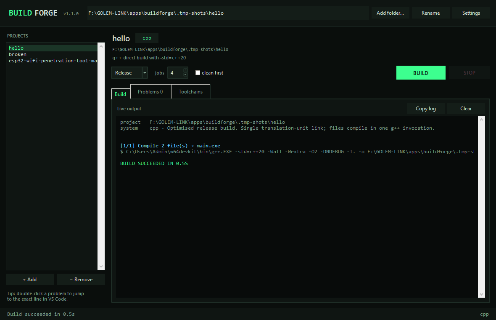
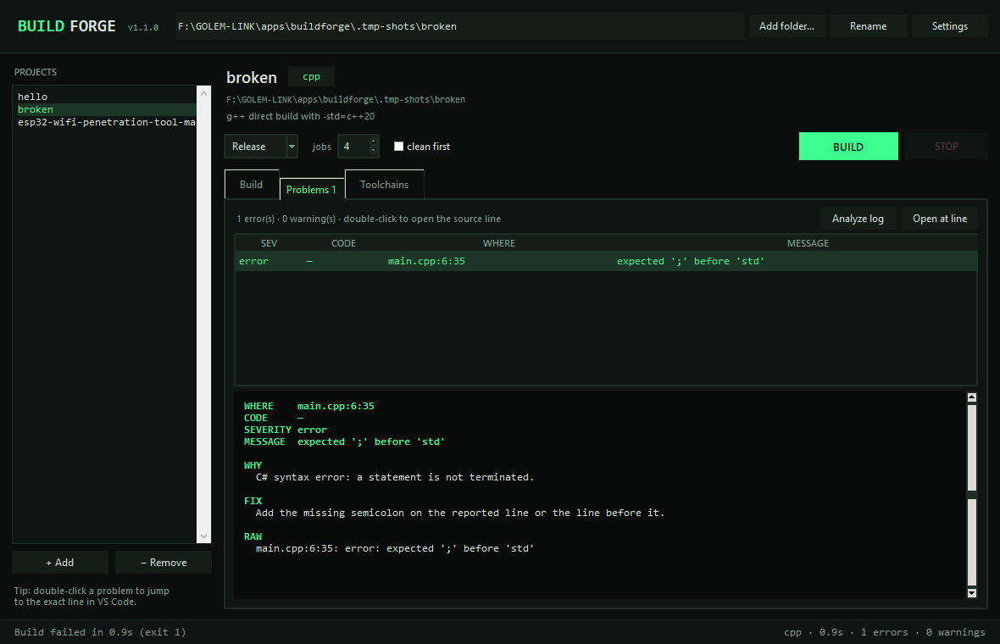
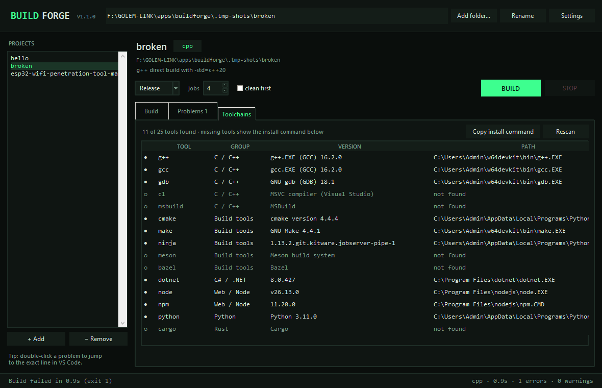
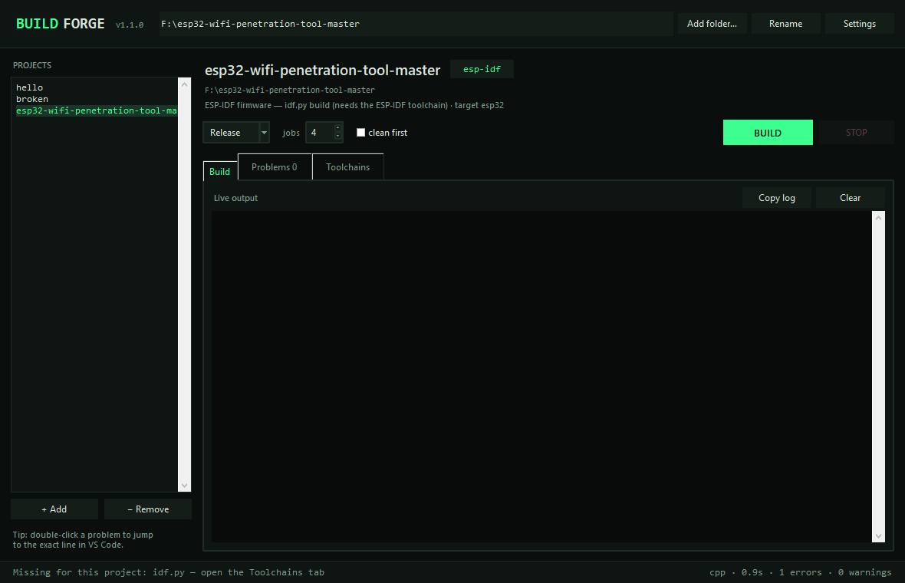

# BuildForge

**One dark desktop console that detects any project on the machine, builds it,
explains every error in plain language, and stays out of the way otherwise.**

[](https://github.com/mrsayrws/BuildForge/releases)
[](#download)
[](https://www.python.org/)
[](tests)

Site: **https://mrsayrws.github.io/buildforge/**



## Download

Grab **BuildForge-1.1.0-win64.zip** from the
[latest release](https://github.com/mrsayrws/BuildForge/releases/latest),
extract the folder and run `BuildForge.exe`. No installer, no services, no
registry writes. Windows 10/11 x64.

## Screenshots

| Build | Problems |
| --- | --- |
|  |  |

| Toolchains | Auto-detection |
| --- | --- |
|  |  |

## What it does

- **Detects the stack from files, not from you.** Rust, Go, CMake, Maven,
  Gradle, Node, Python, .NET (`sln`/`csproj`), MSVC (`vcxproj`), Makefiles,
  ESP-IDF firmware, PlatformIO, Meson, Bazel, qmake and Arduino sketches,
  or plain C/C++ folders. Falls back to a custom command for anything else.
- **Looks inside folders.** A wrapper folder with one project in it is opened
  automatically, and the header tells you where it found it
  (`detected inside …`).
- **Builds incrementally where the ecosystem allows it.** Reuses `build/`,
  `target/`, `obj/`, `node_modules/` and compiler caches, so the second build
  is fast. `clean first` is one checkbox, never a surprise.
- **Explains errors.** GCC, MSBuild, Python, Rust, npm and CMake output is
  parsed into a Problems table with the file:line, WHY it happened and a FIX.
  Double-click jumps to the exact line in VS Code.
- **Checks the toolchain before failing.** 25 tools are scanned; missing ones
  show the exact `winget` command and are highlighted in the Toolchains tab.
  Builds refuse to start when the compiler for the project is missing instead
  of failing cryptically.
- **Finds tools installed after login.** PATH is rebuilt from the registry at
  startup, so a fresh w64devkit or .NET SDK works without a reboot.
- **Cancels cleanly.** Stop kills the whole process tree (`taskkill /T`), not
  just the shell.
- **Keeps output per project.** Selecting another project resets the log and
  the Problems table, so you never read an old error as if it were new.

## Supported stacks

| Kind | Command run |
| --- | --- |
| C / C++ | `g++ -std=c++20` (or `gcc -std=c17`), Release `-O2`, Debug `-O0 -g` |
| CMake | configure once (`Ninja` + local `g++` when MSVC is absent), then `cmake --build` |
| ESP-IDF | `idf.py -B build -j N -DCMAKE_BUILD_TYPE=Release build` with `IDF_TARGET` from `sdkconfig`; stale non-IDF caches are left alone and the build goes to `buildforge-out/` |
| PlatformIO | `pio run -j N` (plus `pio run -t clean` when asked) |
| Arduino | `arduino-cli compile --fqbn <board> --build-path buildforge-out .` |
| Meson | `meson setup build` once, then `meson compile -C build` |
| Bazel | `bazel build //... --jobs=N` |
| .NET | `dotnet build -c Release` (incremental MSBuild) |
| Node | `npm ci`/install when needed, then `npm run build` |
| Python | `python -m compileall` syntax + bytecode pass |
| Rust | `cargo build --release` |
| Go | `go build ./...` |
| Maven / Gradle | `mvn package -DskipTests`, `gradle build` (or `gradlew`) |
| MSVC | `msbuild /p:Configuration=Release /m` |
| Make | `make -jN` |
| qmake | `qmake` then `make -jN` |
| Anything | your custom command from Settings |

## Detection order

BuildForge checks markers in this order and stops at the first match, so an
ESP-IDF project with a `CMakeLists.txt` is never mistaken for a desktop CMake
project:

1. `Cargo.toml` → Rust
2. `go.mod` → Go
3. `platformio.ini` → PlatformIO
4. `sdkconfig` / `sdkconfig.defaults` / `idf_component_register` /
   `include($ENV{IDF_PATH}/...)` → ESP-IDF (target read from env,
   `sdkconfig`, `sdkconfig.defaults`, default `esp32`)
5. `CMakeLists.txt` → CMake
6. `pom.xml` → Maven, Gradle files → Gradle
7. `package.json` → Node
8. `pyproject.toml`, `requirements.txt`, `setup.py` → Python
9. `sln` / `csproj` → .NET, `vcxproj` → MSVC
10. `meson.build`, Bazel files, `*.pro`, `Makefile`
11. `*.ino` sketches (depth 3), then plain C/C++ sources, then plain Python
    scripts (depth 5)
12. Nested folders: a single project directly inside the chosen folder is
    opened automatically
13. Anything else → `unknown`, which asks for a custom command instead of
    guessing wrong

## CLI

BuildForge is also scriptable — the GUI is a client of the same engine:

```bat
python -m buildforge --detect C:\path\to\project --json
python -m buildforge --build C:\path\to\project --debug --jobs 8
python -m buildforge --build . --custom "pytest -q" --timeout 900
python -m buildforge --doctor
```

`--detect` prints kind, sources, entry point and target; `--doctor` lists all
25 tools with versions and install commands.

## Run from source

```bat
python -m buildforge
```

No third-party runtime dependencies: Python 3.11+, standard library and
Tkinter only. Development tools:

```bat
python -m pip install -r requirements-dev.txt
python -m pytest tests -q
```

## Build the exe

```bat
python -m PyInstaller --noconfirm --clean BuildForge.spec
```

Output: `dist\BuildForge\BuildForge.exe` (windowed, icon, version resource).
Ship the whole `dist\BuildForge` folder — it is a onedir build and starts in
about a second.

## Tests

```bat
python -m pytest tests -q
```

83 tests: detection fixtures for every supported stack, diagnostics samples
for each compiler, plan command construction (including ESP-IDF targets and
stale-cache handling), runner streaming/failure/cancel paths, toolchain
preflight, store roundtrips and Tk smoke tests.

## Where it writes

- Settings and build history: `%APPDATA%\BuildForge\config.json`
- CMake: the project's own `build\` folder
- Direct C/C++ builds: `buildforge-out\` inside the project
- ESP-IDF with a foreign cache: `buildforge-out\` (nothing is deleted)
- Everything else: the project's normal output folder

No services, no registry writes, no background process. Uninstalling is
deleting the folder (and optionally `%APPDATA%\BuildForge`).

## Good to know

- Direct C/C++ folders are built with one compiler invocation per build.
  That is perfect for small tools; large C++ trees belong in a CMake or Make
  project, where BuildForge only rebuilds what changed.
- ESP-IDF needs the SDK itself (`winget install --id Espressif.EIM-CLI`, then
  `eim install`). Detection and the build plan work without it; the app tells
  you what is missing instead of failing at compile time.

## Layout

```
buildforge/
  detect.py       project discovery and stack detection
  runner.py       per-stack build plans and process runner
  diagnostics.py  compiler output -> file:line + WHY + FIX
  toolchains.py   25-tool scan, PATH rebuild, toolchain preflight
  gui.py          Tkinter console
  store.py        settings, recent projects, build history
tests/            83 tests
docs/             screenshots
```
